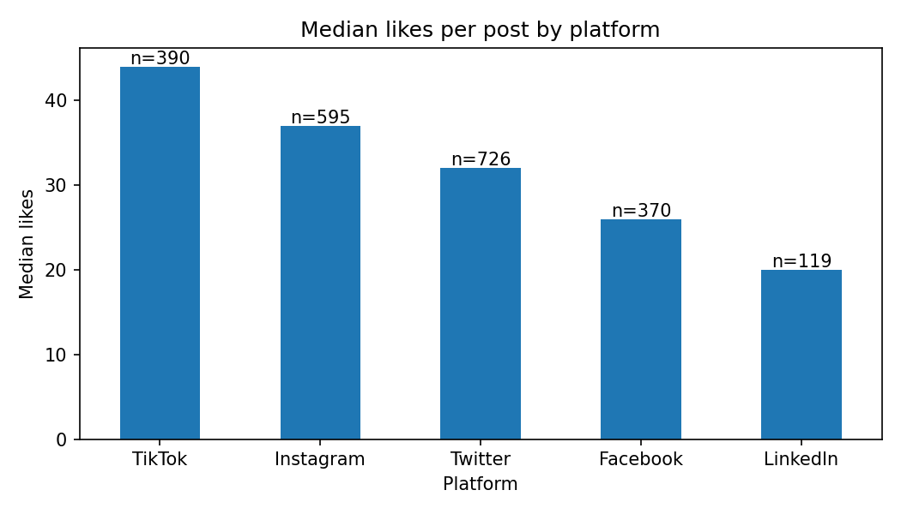
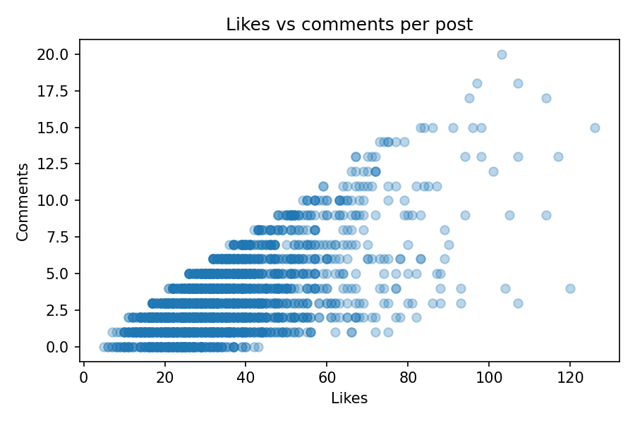

# Social Media Engagement EDA

**Big Data Analytics, Project 1** | Mohammad Hassam Makki

From 2,200 social media posts to a marketing decision, using ordinary tools (Python, Pandas, Matplotlib) before asking whether a scalable tool is needed.

## Business question

A brand posts on social media. Which platform and which kind of content gets the most attention, and what should it test next?

## Dataset

- **Source:** [mrudukp/social-media-sentiment-analysis](https://github.com/mrudukp/social-media-sentiment-analysis) by Mrudula KP (`social_media_sentiment_raw.csv`).
- **License:** not specified. For that reason the CSV is **not redistributed** in this repo.
- **Provenance:** unverified. The post text looks templated, so the data may be synthetic. It is also multi-platform and not specific to Pakistani brands, so it is used to practise the workflow and not to make claims about Pakistan.
- **Size:** 2,260 raw rows and 13 columns. One row is one post. After cleaning: 2,200 posts.
- See [`data_dictionary.md`](data_dictionary.md) and [`data/README.md`](data/README.md).

## How to run

1. Download `social_media_sentiment_raw.csv` from the source repo above and place it in `data/`.
2. `pip install pandas matplotlib seaborn psutil jupyter`
3. Open `project1_social_media_analysis.ipynb` and run all cells in order.

## Method

**Data quality checks.** 44 exact duplicates were found. After standardizing text casing (for example "TWITTER" vs "Twitter"), 60 rows were exact duplicates, so 16 had been hidden by casing. All 60 were removed.

| Problem | Decision |
|---|---|
| `followers_count` stored as text with commas | Commas removed, converted to a number. 88 missing kept as NaN. |
| 8 posts with -1 likes | Treated as invalid and set to NaN, not guessed as 0. |
| 44 missing `comments` | Kept as NaN, not assumed 0, because blank may mean "not collected". |
| Missing `verified`, `country`, `sentiment` | Labelled "Unknown" and kept. |
| Missing `hashtags` (762) | Treated as "no hashtags". |

**EDA.** Mean and median likes and comments by platform and by sentiment, always shown with group sizes. Correlations between likes, shares and comments. A follower-adjusted check (likes per 1,000 followers).

## Findings

### Finding 1: TikTok posts get the most engagement and LinkedIn the least

- **Evidence:** median likes are 44 (TikTok, n=390), 37 (Instagram), 32 (Twitter), 26 (Facebook) and 20 (LinkedIn, n=119). The ranking is the same for median comments and total engagement. TikTok also has the smallest accounts (median 1,474 followers) and the highest likes per 1,000 followers (27.97 vs 10.54 for LinkedIn), so the lead is not just an audience-size effect.
- **Action:** test more short-form TikTok content and compare channels using likes per 1,000 followers.
- **Limitation:** 88 posts with missing follower counts are excluded from the adjusted comparison. The data is not specific to Pakistani brands.

*What the chart shows: TikTok is highest (44), then Instagram (37), Twitter (32), Facebook (26) and LinkedIn lowest (20).*

### Finding 2: positive-sentiment posts get more likes, on every platform

- **Evidence:** median likes are 39 (positive, n=879), 32 (negative, n=636) and 28 (neutral, n=652). The same order holds within each platform, and the sentiment mix is similar across platforms (37-43% positive), so it is not a platform effect.
- **Action:** A/B test positive-toned captions against neutral ones on the same platform.
- **Limitation:** this is an association, not proof of cause. We don't know how the sentiment labels were produced, and the data may be synthetic.

### Supporting observation: likes and comments move together

Likes correlate 0.68 with shares and 0.66 with comments.

*What the chart shows: a generally positive relationship. Posts with few likes (10-40) mostly have few comments, posts with 50-80 likes tend to have more, and some posts around 100-120 likes have relatively high comments. There are a few exceptions with many likes but few comments.*

The top 10% of posts hold only 20.4% of all likes, so a few viral posts are not driving the averages.

## Recommendation

Run a controlled test that moves some content effort to short-form TikTok posts with a positive tone, and judge it by likes per 1,000 followers. This dataset has no spend, impressions or conversions, so it cannot show return on ad spend (ROAS).

## Scaling experiment

The same simple analysis was run on repeated copies of the cleaned data. The repeated data is a **scaling experiment, not new evidence.** Hardware: Intel Core i5-5300U (2.3 GHz), 16 GB RAM, SSD.

| Rows | File | Load | Analysis | Dedupe | DataFrame memory | Process RAM |
|---|---|---|---|---|---|---|
| 2,200 | 0.4 MB | 0.04 s | 0.01 s | 0.01 s | 1.8 MB | 185 MB |
| 22,000 | 4.3 MB | 0.11 s | 0.02 s | 0.03 s | 17.9 MB | 185 MB |
| 220,000 | 43.4 MB | 1.76 s | 0.12 s | 0.48 s | 179.5 MB | 216 MB |
| 2,200,000 | 434 MB | 12.28 s | 0.94 s | 4.37 s | 1,794.5 MB | 502 MB |

Full results are in [`scaling_results.csv`](scaling_results.csv).

- Pandas handled 2.2 million rows on this machine without failing. Loading the file and removing duplicates were the slowest steps.
- DataFrame memory counts each repeated text value separately, so it overstates real use. Process RAM is what the process actually held.
- Repeated copies of the same rows are easier to load than real, varied data, so real data of this size could be slower.
- Spark is worth investigating only when data volume, processing time or distributed storage needs justify it, for example far larger data or repeated pipelines. It is not needed for a 2,200-row file.

## Limitations

- Multi-platform data of unverified provenance that may be synthetic; not specific to Pakistani brands.
- Only organic engagement metrics. There is no reach, impressions, spend or conversions.
- Findings are associations, not causes.

## Next step

Add genuine or clearly labelled sample paid-campaign data (spend, impressions, clicks, conversions) before moving to Meta Ads and Google Ads analysis. Classification, clustering and regression could then be used, with a train/test split and care to avoid data leakage.

## Credit

Dataset by Mrudula KP. All analysis and conclusions in this repo are my own.
